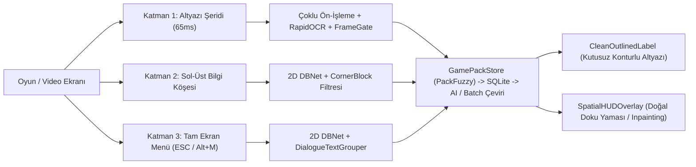

<div align="center">

# 🎮 ReplikAI Pro

### Yapay Zeka Destekli Gerçek Zamanlı Oyun Altyazı, HUD & Menü Çeviri Motoru

[](https://www.python.org/)
[](https://doc.qt.io/qtforpython-6/)
[](https://github.com/RapidAI/RapidOCR)
[](#)
[](#neden-replikai)
[](LICENSE)

**Oyun dosyalarına dokunmadan, DLL enjekte etmeden ve ban riski olmadan; tüm PC oyunlarındaki altyazıları, köşe bilgi kartlarını ve ESC/Harita/Envanter menülerini gerçek zamanlı olarak Türkçeye çevirip oyunun tam üstünde gösteren açık kaynaklı masaüstü motoru.**

[Özellikler](#-3-katmanlı-hibrit-mimari) •
[Kurulum](#%EF%B8%8F-kurulum) •
[Kullanım & Kısayollar](#%EF%B8%8F-kısayollar-ve-kullanım) •
[Oyun Paketleri](#-hazır-oyun-paketleri-gamepacks) •
[Mimari](#%EF%B8%8F-proje-yapısı) •
[SSS](#-sıkça-sorulan-sorular-sss)

</div>

---

## 🛡️ Neden ReplikAI?

Birçok AAA oyun resmi Türkçe dil desteği olmadan çıkış yapıyor. Oyuncular ise:
- Denetimsiz sitelerden `.exe` uzantılı yama indirirken **zararlı yazılım / trojan** riskiyle karşılaşıyor,
- Oyun dosyaları değiştiği için **BattlEye, Easy Anti-Cheat (EAC)** gibi korumalarda **ban riski** yaşıyor,
- Her oyun güncellemesinde bozulan yamalarla uğraşıyor.

**ReplikAI Pro** bu sorunları kökten çözer:
- **%100 Anti-Cheat Güvenli:** Oyun dosyalarını değiştirmez, bellek (RAM) okumaz, DirectX'e DLL enjekte etmez. Yalnızca ekran piksellerini okur ve şeffaf bir Win32 katmanı (`WS_EX_TOOLWINDOW | WS_EX_LAYERED | WS_EX_TRANSPARENT | WS_EX_TOPMOST`) üzerinden çizim yapar.
- **Kendi Çevirisini Görmez:** Windows `WDA_EXCLUDEFROMCAPTURE` izolasyonu sayesinde OCR kamerası ReplikAI'nin kendi Türkçe katmanını görmez, doğrudan arkadaki orijinal oyun görüntüsünü okur.
- **Sıfır FPS Kaybı:** İşlem önceliği otomatik olarak `BELOW_NORMAL` seviyesine çekilir; canlı oynanışta tam ekran yerine yalnızca küçük altyazı şeridi ve sol-üst bilgi köşesi taranır.

---

## ⚡ 3 Katmanlı Hibrit Mimari

ReplikAI, canlı oynanış performansını korurken menülerde `%99+` kapsama sağlamak için **3 bağımsız katman** halinde çalışır:

| Katman | Görev | Nasıl Çalışır? | Gecikme / FPS Etkisi |
| :--- | :--- | :--- | :--- |
| **1. Katman — Canlı Altyazı Motoru** | Oyun içi sinematik diyaloglar ve tam ekran video altyazıları | Evrensel alt-orta altyazı bandını (`65ms` döngü) izler. Çoklu ön-işleme (`Ham` + `Beyaz Harf Yalıtımı` + `Otomatik Kontrast`) + İngilizce okunabilirlik puanlaması ve garantili 2D DBNet yedeğiyle güneşli zeminlerde bile 1-3 satırlık altyazıları okur. | `~160–200 ms` toplam tepki • **%0 FPS kaybı** |
| **2. Katman — Köşe Bilgi Kartı Radarı** | Sol-üstte aniden çıkan görev/ipucu/uyarı kutuları | Tüm ekran yerine yalnızca sol-üst köşe şeridini (`~%9` ekran) izler. Harf-ritmi maskesiyle hareketli 3D sahnede bile bilgi kartını yakalar; `CornerBlock` filtresiyle harita/gürültü etiketlerini eler ve 2D DBNet ile yerinde (**In-Place**) çevirir. | `~0.5 ms` tarama • **~%0 FPS kaybı** |
| **3. Katman — Tam Ekran Menü / Envanter Tarayıcı** | `ESC` menüleri, ayarlar, harita, envanter ve diyalog özetleri | `GetCursorInfo` (imleç görünürlüğü), `ESC` tuş mandalı (`0x8001`) veya `Alt + M` ile tetiklenir. Gerçek **2D DBNet** + limitsiz **Toplu (Batch) Çeviri** ile ekrandaki tüm kelimeleri tek seferde çevirir. `ESC` ile oyuna dönüldüğü an (`< 35ms`) tüm yamaları temizler. | Tek seferlik toplu çeviri • **%0 FPS kaybı** |



---

## ✨ Öne Çıkan Mühendislik Özellikleri

- **🎨 Doğal Arka Plan Doku Yaması (`RealtimeNaturalBackground`):** Oyun içi menü ve bilgi kartlarının üstüne yapay düz renkli kutu çizmek yerine, orijinal İngilizce harfleri etraftaki temiz arka plan piksellerinden dikey medyan enterpolasyonu (`Inpainting`) ile siler.
- **🌈 WCAG 2.0 Orijinal Font Rengi & Kontur Koruma (`SourceTextColorSampler`):** Oyundaki sarı görev vurgularını, kırmızı uyarıları veya beyaz menü metinlerini `HSL` doygunluk düzeltmesi ve 16 adımlı WCAG kontrast aramasıyla oyunun kendi tasarımına birebir uyarlar.
- **🗣️ Konuşmacı Adı Koruması (`SpeakerLabel`):** `"Michael: Get in the car!"` gibi diyaloglarda konuşmacı adını çeviri motoruna sokmadan korur, yalnızca konuşmayı çevirip `"Michael: Arabaya bin!"` şeklinde birleştirir.
- **🧠 Sahne Hafızalı & Bağlamsal Çeviri:** Son 6 repliği bağlam hafızasında tutar; bölünmüş/yarım cümleleri dinamik olarak birleştirir, halihazırda Türkçe olan metinleri tekrar çevirmez.
- **📦 Hazır Oyun Paketleri (`GamePackStore` + `PackFuzzy`):** `data/packs/` klasörüne bırakılan `.json` / `.json.gz` oyun paketlerini otomatik yükler; OCR 1-2 harf yanlış okusa bile bulanık eşleştirme (`PackFuzzy`) ile **0.0 ms** içinde hatasız çeviri basar.
- **🛡️ `FrameGate` Akış Kapısı:** Önceki karenin okuması bitmeden kuyruk biriktirmez; eski/gecikmiş bir çevirinin güncel altyazıyı ezmesini engeller.
- **🤖 Çoklu Çeviri Motoru Desteği:**
  - **Ücretsiz Hızlı Motor (`free_fast`)** — API anahtarı gerektirmez, kalıcı TLS 1.3 Keep-Alive oturumuyla `~80–120ms`.
  - **Google Gemini** (`gemini-2.5-flash`), **OpenAI** (`gpt-4o-mini`) ve **Yerel Çevrimdışı Ollama** (`gemma2`, `llama3`).
  - **Kalıcı SQLite Önbellek (`data/cache.db`)** — Önceden çevrilen her replik ve menü terimi **0 ms** gecikmeyle anında getirilir.

---

## 🛠️ Kurulum

### Gereksinimler
- **İşletim Sistemi:** Windows 10 / 11 (64-bit)
- **Python:** 3.10 veya üzeri

### 1. Repoyu Klonlayın
```bash
git clone https://github.com/BerkeKeklicek/ReplikAI.git
cd ReplikAI
```

### 2. Bağımlılıkları Yükleyin
```bash
pip install -r requirements.txt
```

### 3. Uygulamayı Başlatın
Doğrudan `baslat.bat` dosyasına çift tıklayabilir veya terminalden çalıştırabilirsiniz:
```bash
python main.py
```
> **Not:** GTA 5, RDR 2 gibi Yönetici (Administrator) yetkisiyle çalışan oyunların üstüne Windows güvenlik kuralları (`UIPI`) gereği çizim yapabilmek için ReplikAI açılışta otomatik olarak Yönetici izni (`UAC`) ister.

---

## ⌨️ Kısayollar ve Kullanım

| Kısayol | İşlev |
| :--- | :--- |
| **`Alt + T`** | Canlı Altyazı & HUD Takibini Başlat / Durdur |
| **`Alt + M`** | Ekrandaki Tüm Menü / Harita / Envanter Metinlerini Tek Tuşla Çevir (ESC'ye basınca `<35ms` içinde silinir) |
| **`Alt + R`** | Lazer HUD Bölge Seçici ile Özel Altyazı Alanı Çiz |
| **`Alt + L`** | Altyazı Katmanını Kilitle (Hayalet Tıklama Geçirgen Mod) / Kilidi Açıp Taşı |
| **`Alt + C`** | Anlık Tek Kare Altyazı Çevir |
| **`Alt + B`** | Aktif Oyun Penceresini Çerçevesiz Tam Ekran (Borderless) Moduna Al |

### Oyun İçi Görüntü Ayarı (Önemli)
Anti-Cheat güvenli (DLL enjekte etmeyen) tüm Windows çeviri yazılımlarında olduğu gibi, çevirinin oyunun tam üstünde görünmesi için:
1. Oyun içi grafik ayarlarından ekran modunu **`Windowed Borderless` (Çerçevesiz Pencere)** olarak seçin.
2. *(Windows 11'de overlay yine arkada kalırsa)* **Windows Ayarlar $\rightarrow$ Sistem $\rightarrow$ Ekran $\rightarrow$ Grafikler $\rightarrow$ Varsayılan grafik ayarlarını değiştir** bölümünden **"Pencereli oyunlar için iyileştirmeler"** seçeneğini kapatın.

---

## 📦 Hazır Oyun Paketleri (`GamePacks`)

`data/packs/` klasörüne `.json` veya sıkıştırılmış `.json.gz` formatında oyun çeviri paketi ekleyerek belirli oyunlarda **0.0 ms** gecikmeyle, çevrimdışı ve %100 tutarlı çeviriler alabilirsiniz:

```json
{
  "Lose the cops.": "Polisleri atlat.",
  "Get back in the vehicle.": "Araca geri dön."
}
```
Uygulama açılışta `data/packs/` altındaki tüm paketleri otomatik indeksler ve `PackFuzzy` motoruyla ufak OCR harf kaymalarında bile doğru karşılığı eşleştirir.

---

## 🏗️ Proje Yapısı

```text
ReplikAI/
├── main.py                          # Giriş noktası (UAC Yönetici yükseltme + PerMonitorV2 DPI + PassThrough)
├── baslat.bat                       # Windows tek tıkla başlatıcı
├── requirements.txt                 # Python bağımlılıkları
├── replikai/
│   ├── config.py                    # Kalıcı JSON yapılandırma & AAA oyun profilleri (GTA 5, RDR 2, RPG, Cyberpunk vb.)
│   ├── core/
│   │   ├── capture.py               # MSS kalıcı oturumlu yakalayıcı & çift kanallı Top-Hat/Comb altyazı maskesi
│   │   ├── ocr_engine.py            # RapidOCR ONNX + 2-satır vadi ayırıcı + çoklu ön-işleme + 2D DBNet motoru
│   │   ├── translator.py            # Bağlamsal AI (Gemini, OpenAI, Ollama, Google Fast) & Toplu (Batch) çeviri
│   │   ├── pipeline.py              # 3 Katmanlı Hibrit iş hattı (Altyazı + Köşe Bilgi Kartı + Otomatik Menü)
│   │   ├── hud_radar.py             # 2D DBNet blok gruplayıcı, parmak izi takibi ve anlık oyun terimleri sözlüğü
│   │   ├── natural_patch.py         # Doğal arka plan doku yaması (Inpainting) & WCAG 2.0 / HSL renk örnekleyici
│   │   ├── dialogue_grouper.py      # Konuşmacı adı ayırıcı (SpeakerLabel), paragraf birleştirici & CornerBlock filtresi
│   │   ├── frame_gate.py            # Tek-kare akış kapısı ve takılma (stuck-frame) koruması
│   │   ├── game_packs.py            # Hazır oyun paketleri (.json / .json.gz) ve PackFuzzy bulanık eşleştirici
│   │   ├── game_window.py           # Win32 pencere tespiti, GetCursorInfo imleç takibi & WDA_EXCLUDEFROMCAPTURE
│   │   └── cache.py                 # SQLite tabanlı 0 ms kalıcı çeviri önbelleği
│   └── ui/
│       ├── dashboard.py             # Qt6 Pro Komuta Merkezi, canlı monitör, ayarlar ve çeviri geçmişi
│       ├── overlay.py               # Kutusuz, vektörel konturlu (QPainterPath) Hayalet Altyazı Katmanı
│       ├── hud_overlay.py           # Tam ekran yerinde (In-Place) doğal doku yamalı HUD & Menü Katmanı
│       └── region_selector.py       # Tam ekran etkileşimli bölge seçici HUD
└── tests/
    └── test_core.py                 # Birim testleri
```

---

## ❓ Sıkça Sorulan Sorular (SSS)

<details>
<summary><b>1. Online oyunlarda (GTA Online vb.) ban yer miyim?</b></summary>
<br>
ReplikAI hiçbir oyun dosyasını değiştirmez, oyun belleğini okumaz ve DirectX/Vulkan içine DLL enjekte etmez. Yalnızca ekran görüntüsü alır ve Windows'un standart şeffaf pencere katmanına yazı çizer.
</details>

<details>
<summary><b>2. Altyazılar oyunun üstünde görünmüyor, sadece Alt+Tab atınca görünüyor. Neden?</b></summary>
<br>
İki temel sebebi vardır:
1. Oyun <b>Exclusive Fullscreen (Özel Tam Ekran)</b> modundadır. Oyunun grafik ayarlarından <b>Windowed Borderless (Çerçevesiz Pencere)</b> moduna geçin.<br>
2. Windows 11'de <b>Pencereli oyunlar için iyileştirmeler</b> (DXGI Independent Flip) açıksa, Windows Ayarlar → Sistem → Ekran → Grafikler üzerinden kapatın.
</details>

<details>
<summary><b>3. Tamamen ücretsiz kullanabilir miyim?</b></summary>
<br>
Evet! Varsayılan <b>Ücretsiz Hızlı Motor</b>, yerel <b>RapidOCR (ONNX)</b>, <b>SQLite Önbellek</b> ve <b>Yerel Ollama</b> desteği sayesinde hiçbir ücretli API anahtarına ihtiyaç duymadan tamamen ücretsiz çalışır. İsterseniz kendi Gemini veya OpenAI anahtarınızı da ekleyebilirsiniz.
</details>

---

## 📄 Lisans

Bu proje **[MIT Lisansı](LICENSE)** altında açık kaynaklı olarak dağıtılmaktadır.
